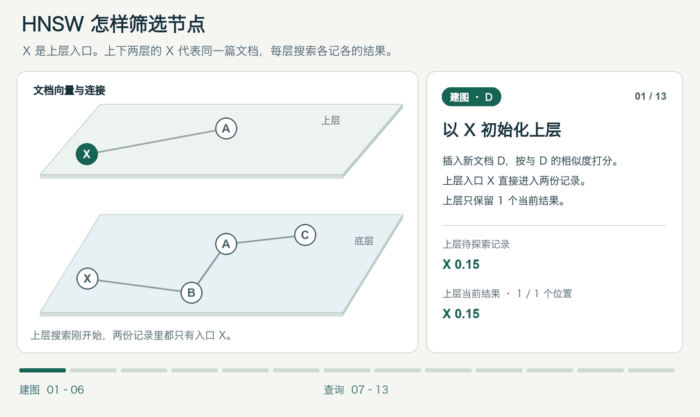

[返回检索基础目录](index.md)

# 索引、近似检索与重排

遇到一次不好的检索，先看它具体坏在哪里。程序可能已经算遍全部文档，却把无关内容排得很高；也可能得到的排名很好，只是文档多了以后算得太慢。这两种情况需要检查不同部分。

本课讲清向量索引怎样减少搜索工作，以及重排怎样重新检查候选文档。你会据此整理实验结果，为下一阶段选一个有依据的改动，不在本课安装数据库或实现 HNSW。

## 1. 逐篇检索已经给出了一个重要参照

第三课对每个问题计算全部文档的余弦，再取 Top-K。固定模型、输入、相似度方法与并列规则后，这个结果就是该计算方式下的精确排名。

这里的精确指没有漏算任何文档。它与人工相关性仍有差别。模型生成的表示可能没有把正确资料排到前面，检查全部向量也不会自动修复这种表示问题。

文档增加时，逐篇计算的工作量也增加。若有 N 篇文档，每篇 d 个数，每次查询的相似度计算规模大致随 `N × d` 增长。单个 32 位浮点数占 4 字节，50 条 384 维向量仅向量数据就需要 `50 × 384 × 4 = 76,800` 字节，约 75 KiB。这里还没有计算原文、编号和程序本身的占用。

本阶段先用小语料逐篇计算，得到精确 Top-K，作为后续比较的参照。文档更多时，可以尝试减少查询时的向量比较次数来加快检索，下一节会介绍这类近似检索方法。对同一个问题、同一批文档，将近似检索的结果与精确 Top-K 对照，就能检查是否漏掉了原本排在前 K 名的文档。

## 2. 用近似最近邻检索（ANN）加快查询

最近邻检索是在选定相似度或距离下找最近的向量。近似最近邻检索允许结果与逐篇计算得到的精确 Top-K 有一定差别，以换取更快的查询。这类检索方法统称为 ANN，英文是 Approximate Nearest Neighbor。

ANN 方法通常借助索引来减少查询时的比较次数。索引是为了加快查找而提前组织的数据结构。这里使用的向量索引帮助查询缩小搜索范围，减少需要逐一比较的向量数量。

采用 ANN 后，需要同时检查查询耗时、索引占用与漏掉近邻的程度。具体取舍取决于采用的方法、参数和数据，需要通过实验比较。

### 以 HNSW 为例理解 ANN

HNSW 是一种实现 ANN 的具体方法，英文全称是 Hierarchical Navigable Small World。

在 HNSW 中，建索引就是把文档向量组织成一张多层图。每个点代表一个文档向量，点之间的连接记录从当前点可以继续访问哪些点。动画里的 X 是一个已有的文档节点，也是这张图的搜索入口。上下两层的 X 代表同一篇文档。

建图时，程序要给新文档 D 选邻居，所以用 D 的向量打分。用户提问时，程序要找能返回的文档，就改用问题向量 Q 打分。下面两次搜索都用余弦相似度，分数越高，向量越相似。

#### 每一层怎样记结果

搜索时，暂时纳入考虑的文档向量称为候选。程序用两份记录跟踪它们。**待探索记录** 里是还等着检查连接的节点。程序先取出其中分数最高的节点，查看它连着谁。**当前结果记录** 则保留已经找到的一批节点，有数量上限。一个节点的连接查完了，它仍可能留在当前结果中。

每开始搜索一层，程序都用这一层的入口点初始化两份记录。因此刚从上层的 X 出发时，两份记录中都有 X。随后沿连接发现本层尚未检查过的新节点时，程序按当前结果记录的容量决定是否接纳它。

- **还有空位** 时，新节点直接进入两份记录，分数再低也可以进。
- **已经满了** 时，新节点的分数必须严格高于当前结果里的最低分，才进入两份记录，并从当前结果中移除一个最低分节点。分数相等或更低，两份记录都不加入它。

最底层包含全部文档向量，较高层只保留其中一部分点。上层搜索只保留一个当前结果。如果相邻点得分更高，程序就沿连接走过去。在上层找不到更高分的相邻点时，程序用这一层找到的最好节点作为下一层的入口，在新一层重新建立两份记录。这样，程序可以先借助高层跨度较大的连接找到合适的起点，再到底层检查更多文档。



#### 插入文档 D 时，X 进入了哪些记录

假设 D 只加入底层。为了把搜索和连边的区别讲清楚，本例在底层搜索时最多保留 4 个结果，最后按与 D 的相似度选出其中 2 个作为邻居。表中每行都是该步完成后的记录，分数从高到低排列。

| 搜索位置与动作                                              | 待探索记录 | 当前结果记录                               |
| ----------------------------------------------------------- | ---------- | ------------------------------------------ |
| 从上层入口 X 开始                                           | X          | X（0.15）                                  |
| 取出 X，发现 A。上层只留 1 个结果，A 的 0.40 高于 X 的 0.15 | A          | A（0.40）                                  |
| 查完上层的 A，从底层的 A 重新开始                           | A          | A（0.40）                                  |
| 取出 A，发现 B 和 C。底层还有空位，两者都加入               | C、B       | C（0.89）、B（0.82）、A（0.40）            |
| 先查 C，再查 B。从 B 发现底层的 X，此时还剩 1 个空位        | X          | C（0.89）、B（0.82）、A（0.40）、X（0.15） |
| 查完 X，它只连着本层已经查过的 B                            | 空         | C（0.89）、B（0.82）、A（0.40）、X（0.15） |

X 的 0.15 虽然最低，仍占到了第四个空位。等到给 D 连边时，本例只选前两名，因此程序保存 D 与 C、D 与 B 的连接。

#### 用问题 Q 查询时，X 又会怎样

查询同样从上层的 X 开始，但这次分数表示文档与 Q 的相似度。本例在底层最多保留 3 个结果，最后返回前 2 篇。

| 搜索位置与动作                                                                           | 待探索记录 | 当前结果记录                    |
| ---------------------------------------------------------------------------------------- | ---------- | ------------------------------- |
| 从上层入口 X 开始                                                                        | X          | X（0.10）                       |
| 取出 X，发现 A。A 的 0.20 高于 X 的 0.10，替换 X                                         | A          | A（0.20）                       |
| 查完上层的 A，从底层的 A 重新开始                                                        | A          | A（0.20）                       |
| 取出 A，发现 B 和 C。恰好还有两个空位                                                    | C、B       | C（0.80）、B（0.30）、A（0.20） |
| 取出 C，发现 D。记录已满，D 的 0.75 高于最低分 0.20，替换 A                              | D、B       | C（0.80）、D（0.75）、B（0.30） |
| 查完 D，再取出 B，从 B 发现底层的 X。X 的 0.10 低于此时的最低分 0.30，两份记录都不加入 X | 空         | C（0.80）、D（0.75）、B（0.30） |

此时待探索记录已空，程序从当前结果中返回 C 和 D。这里的 0.30 取自这一步的结果记录。前一步判断 D 能否加入时，用的还是 0.20。分层搜索和记录更新的完整流程见 [HNSW 原论文的算法 1、2 和 5](https://arxiv.org/pdf/1603.09320#page=4)。

一次查询通常只访问图中的部分点，因此可以减少相似度计算。但未访问的点中可能有分数更高的文档，这就是近似检索可能漏掉精确 Top-K 的原因。

#### 连接数量和搜索范围的取舍

- 每个点保留更多连接，通常会增加索引内存，也会改变可探索的路径。
- 插入新文档时，多考察一些已有节点，再从中选邻居，通常会增加建图时间，也可能让后续查询更容易找到近邻。
- 查询时提高当前结果记录的容量，通常能让搜索更充分，也会增加查询工作量。

例如，hnswlib 的实现分别使用 `M`、`ef_construction` 和查询参数 `ef` 表达这些设置，详见[维护方的参数说明](https://github.com/nmslib/hnswlib/blob/master/ALGO_PARAMS.md)。这些名称属于该库的配置，其他产品可能使用不同入口。本课不要求记住默认值或提前调参。

## 3. 两种“召回”各自跟谁比较

第四课用人工标注作为参照，检查找回了多少相关文档。评估 ANN 时，还常用逐篇计算的精确 Top-K 作为参照，检查近似搜索找回了其中多少篇。

```text
ANN 对精确近邻的召回
= ANN Top-K 与精确 Top-K 的交集数量 / K
```

例如精确 Top-3 为 `[A, B, C]`，ANN Top-3 为 `[A, D, C]`，对精确近邻的召回为 2/3。这个数没有使用人工相关性标注。

如果人工认为 D 恰好相关，不能只因为它没有出现在精确 Top-3 就把它称为无关文档。反过来，ANN 完全复现了精确排名，也不说明这些文档能回答问题。报告要写清参照对象，避免把两种召回混作同一个指标。

## 4. 向量数据库承担了哪些工作

本阶段的程序已经分别持有原文记录、向量矩阵和检索函数。向量数据库把其中一部分存储、索引与查询工作组织成可复用的服务或库。

| 内容           | 用途                                     |
| -------------- | ---------------------------------------- |
| 文档编号与向量 | 保存每条可检索记录，以及对应的表示       |
| 元数据         | 记录来源、分类、版本等字段，供回查与过滤 |
| 向量索引       | 用逐篇比较或近似方法寻找高分向量         |
| 查询与更新操作 | 接收查询、增删记录并返回结果             |

不同产品还会提供持久化、过滤、备份和并发访问等能力。是否保存完整原文、怎样处理过滤与更新，应查看所选产品的实际行为。

数据库拿到不兼容的向量，无法仅靠保存与索引让它们变得可比。后续接数据库时，应先确认使用的模型、维度和评分方式，再与本阶段的小规模精确结果对照。

## 5. 重排重新比较已经找到的候选

重排，英文为 Reranking，是对初次检索得到的候选再次评分并调整顺序。与第五课合并两份已有排名相比，重排通常会重新查看问题与候选文本。

例如，一类称为 Cross-Encoder 的模型把问题和某篇文档一起作为输入，输出该文档针对这个问题的分数。每篇候选都要做这样的配对计算，所以常先用较快的检索找一小批，再交给它细排。[Sentence Transformers 的检索与重排说明](https://sbert.net/examples/sentence_transformer/applications/retrieve_rerank/README.html)展示了这种分工。

设整个语料中的相关文档为 `{B, E}`，初次检索只交来四篇候选。

| 阶段                 | 排名       |
| -------------------- | ---------- |
| 初次检索的四篇候选   | A、C、B、D |
| 仅调整这四篇后的结果 | B、A、C、D |

第一篇相关文档从第 3 移到第 1。若最后只取两篇，Recall@2 也从 0 提高到 1/2。但四篇候选中的相关文档总数仍只有一篇，E 没有进入候选，单靠重新排序无法找回它。

因此，重排既可能改善第一篇相关文档的位置，也可能改善较小 K 下的召回。它能达到的结果仍受候选集合限制。应同时保存初检候选和最终结果，查看漏检发生在哪一步。

## 6. 怎样判断下一步值得检查什么

先看评测记录里实际出现了什么。下面列的是几种可能的情况，用到哪一行，取决于你手里的证据。

| 如果记录里出现这种情况                            | 先检查什么                             | 下一步可以做什么                                                   |
| ------------------------------------------------- | -------------------------------------- | ------------------------------------------------------------------ |
| 正确文档没有被加载，或正文被意外截断              | 原文、文档准备数量与完整输入           | 先修正文档准备；长文档处理放到下一阶段                             |
| 问题包含明确标识符，但相关文档未进向量检索前 K 名 | 核对标识符在原文中的写法，查看词法排名 | 用已有的两路排名判断第五课的融合办法是否值得继续验证               |
| 相关文档进入了候选，但排在最终展示的前 K 名之外   | 对照候选原文、相关标注和名次           | 固定同一批候选，比较重排前后相关文档的名次，并记录重排耗时         |
| 精确检索的结果合适，语料增大后逐篇比较耗时较长    | 确认查询时间有多少花在向量比较上       | 对同一批向量比较逐篇检索与 ANN 的耗时，检查 ANN 找回了多少精确近邻 |

试用 HNSW 时，可以用已有的文档向量建图，再用同一个问题向量分别做逐篇检索和近似检索。若采用第五节的 Cross-Encoder 做重排，则要用这个模型给问题和每篇候选文档重新打分。模型可以在本地运行。

固定问题集上的结果只说明这批材料的表现，后续换领域或增加长文档时需要重新检查。

## 7. 练习与验收

### 任务 1　区分两种召回与重排范围

下面是两道独立的笔算题。字母代表文档编号，表格给出的就是检索和重排已经返回的结果。

**第一问：近似检索找回了几个精确近邻？** 同一个问题在同一批文档上检索两次，每次取前 3 篇。

| 检索方法                   | 第 1 名 | 第 2 名 | 第 3 名 |
| -------------------------- | ------- | ------- | ------- |
| 逐篇计算相似度（精确检索） | A       | B       | C       |
| 近似最近邻检索（ANN）      | A       | D       | C       |

以第一行的 3 篇文档为参照，列出其中哪些也出现在第二行。把共有的篇数除以 3，写出 ANN 对精确近邻的召回。再说明第四课按人工标注计算 Recall@K 时，分母统计的是哪些文档。这一问只需要表里的文档编号，无须计算向量相似度或运行 ANN。

**第二问：重排改变了哪些指标？** 对另一个问题，人工检查了整个语料库，认定只有 B、E 两篇文档相关。初次检索返回 4 篇，重排只调整这 4 篇的顺序。

| 阶段   | 第 1 名 | 第 2 名 | 第 3 名 | 第 4 名 |
| ------ | ------- | ------- | ------- | ------- |
| 重排前 | A       | C       | B       | D       |
| 重排后 | B       | A       | C       | D       |

分别对两行计算 RR@2、Recall@2 和 Recall@4。算 RR@2 时，只看前两名，取第一篇相关文档名次的倒数，前两名都不相关就记 0。算 Recall@2 和 Recall@4 时，分别数前两名和前四名里有几篇相关文档，再除以人工标出的相关文档总数。

通过条件：第一问写清命中的文档、算式和两种召回各自的参照。第二问给出重排前后各三个指标值，并结合 B 的名次和 E 是否进入候选，解释为什么重排可以改变 Recall@2，以及它能否找回 E。

### 任务 2　根据评测记录判断下一步是否需要改动

从第四课的报告里选一条你想解释的记录，写下自己的判断。关心排序时，引用问题、相关原文和实际名次。关心速度时，引用测得的耗时，并写明这段计时包含哪些操作。第五课已经分析过的结果可以直接引用。

如果现有方法已经够用，可以建议保留它并说明理由。如果建议尝试另一种方法，写清手里已经有哪份结果、还缺哪份结果，以及将来怎样比较。如果还判断不了，指出需要补查的一项证据。

假设一篇相关文档排在第 3 名，而用户只看前两名。保留这批候选文档，用重排模型打分后，这篇文档能进入前两名吗？要回答这个问题，需要把同一个查询与每篇候选文档分别配成一对，交给选定的模型打分，再按新分数从高到低排序，查看这篇文档的名次。选择这个方案时，写清怎样比较就够了。

这是一道书面分析题。通过条件是读者能从你引用的记录看出判断依据，并理解你建议比较什么、为什么保留现有方法，或还需要查明什么。提出比较方案时，把预期观察的结果写成待验证的问题。

### 知识检查

说明倒排索引、HNSW、RRF 与重排分别在哪一步工作。再解释向量数据库可以接手哪些存储和查询工作，哪些模型与数据问题仍要由应用检查。

## 参考资料

- [HNSW 原论文](https://arxiv.org/abs/1603.09320)。
- [hnswlib 的参数说明](https://github.com/nmslib/hnswlib/blob/master/ALGO_PARAMS.md)。
- [Sentence Transformers 的检索与重排说明](https://sbert.net/examples/sentence_transformer/applications/retrieve_rerank/README.html)。

打开 [RAG 检索基础目录](index.md)，按“本阶段的综合验收”一节整理已有实现、实验与书面结果，再继续 RAG 实战。
